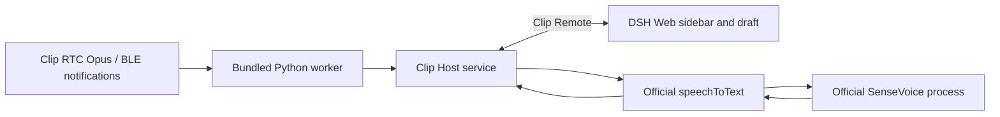

# Clip for DeepSeek Harness

[简体中文](README.md) · **English**

Record on reSpeaker Clip, see a live waveform in DSH, and transcribe the recording into your chat draft with local SenseVoice when it stops. The Clip panel offers two modes. RTC receives Opus audio over Bluetooth Low Energy (BLE) as you record. SD records on the device and syncs the file after you stop.

## Compatibility

| DSH version | DSH Host platform | Clip version |
| --- | --- | --- |
| `0.2.2-rc.1` or `0.2.2-rc.3` | Windows x64 or Linux x64 | `0.3.8` |

The computer running the DSH Host needs Bluetooth, and Linux also needs BlueZ. Running DSH Web requires Node.js `24.9.0` or later. The Electron desktop app provides its own runtime. The same Clip package uses the official speech recognition components bundled with either supported DSH version.

RTC uses the SDK and protocol from the reSpeaker Clip `clip_agent` branch. RTC mode requires firmware that supports `AT+START=rtc`. Use SD mode with older firmware. If the firmware supports the RTC double-press shortcut, you can also start and stop recording with the physical button after connecting.

The Clip panel and recording prompts follow the DSH interface language. Switch between Chinese and English in **Settings → General → Language**. Clip uses English for other interface languages.

## Option 1. Install from the plugin manager

In DSH Web or the Electron desktop app, open **Plugins → Add plugin** and enter this GitHub link. To install from npm, enter `dsh-clip-for-agent@0.3.8`. [npm package](https://www.npmjs.com/package/dsh-clip-for-agent)

```text
git+https://github.com/Ant-wkp/dsh-clip-for-agent.git#v0.3.8
```

Enable the plugin after installation. Restart DSH if prompted, then open **Clip** in the sidebar.

## Option 2. Install from the command line

| Interface | Profile |
| --- | --- |
| `dsh web` (browser) | `web` |
| Electron desktop app | `desktop` |

For desktop, start the app once to initialize the `desktop` profile and run the command from the app's built-in DSH terminal. Choose the command for your interface.

```bash
dsh plugin --profile web add 'git+https://github.com/Ant-wkp/dsh-clip-for-agent.git#v0.3.8'
dsh plugin --profile desktop add 'git+https://github.com/Ant-wkp/dsh-clip-for-agent.git#v0.3.8'
```

Start or restart that DSH interface after installation and check that Clip is enabled in the plugin manager.

If `dsh --version` shows Dancer's Shell, replace `dsh` in the web command with `npx @deepseek-ai/dsh@0.2.2-rc.1` or `npx @deepseek-ai/dsh@0.2.2-rc.3`. Match the version of your DSH Web installation.

## Option 3. Install from source

```bash
git clone --branch v0.3.8 https://github.com/Ant-wkp/dsh-clip-for-agent.git
cd dsh-clip-for-agent
npm run build
```

Choose the command for your interface.

```bash
# Linux · DSH Web
dsh plugin --profile web add "file:$(pwd)"
```

```powershell
# Windows PowerShell · DSH terminal in the Electron desktop app
dsh plugin --profile desktop add "file:$($PWD.Path)"
```

Use the full path to the plugin directory containing `package.json` and `cordis.patch.yml` after `file:`. The build generates `lib/client.js` and uses the Windows and Linux x64 workers bundled in the repository. If you change the Python device code, rebuild the relevant worker as described below.

## Use Clip

1. Open **Clip** in the DSH sidebar. Choose **Scan for devices**, then **Pair and connect** next to your device.
2. Under **Clip → Recording results → Recording mode**, choose **RTC live audio** or **SD recording (sync on stop)**. Clip defaults to RTC and remembers your choice in the current browser or desktop app. To dictate into a chat, open it and click the Clip microphone in the composer. You can also start a recording from the Clip panel.
3. Click the stop button or use the physical button if your device supports it. RTC receives audio during recording and decodes it after the end frame arrives. SD downloads and decodes the file after you stop. Both modes use local SenseVoice. If you stay in the original chat and the draft stays the same, Clip inserts the transcript at the original cursor position. You can also insert the result manually.
4. RTC stops automatically after 120 seconds. If Bluetooth disconnects during RTC recording or the end frame is missing, record again. For SD recordings, reconnect to retry the sync or select **Sync latest SD recording**.

On first use, choose **Install the SenseVoice model** under **Clip → Speech recognition**. The panel shows download progress. If the official speech recognition component is disabled, click **Install official speech recognition** to install or enable it from the Clip panel. The panel indicates when DSH needs a restart. Clip shares the model cache with the official voice input plugin and reuses its running service and local SenseVoice instance when that bundle is enabled. Each recording supports up to 120 seconds of speech input. Clip inserts the transcript into the draft for you to send.

## Architecture and development



The `clip` Remote uses DSH Gateway authentication and streams status updates. The Python worker calls SDK methods `start_rtc` and `stream_rtc` to receive `STREAM_START`, `STREAM_DATA`, and `STREAM_END` notifications. After recording, libopus decodes the audio to 16 kHz mono PCM16 WAV for local SenseVoice. The Web client receives status, waveform levels, and transcripts. SD mode uses the SDK file transfer with CRC32 validation.

To try the demo, add `?clip-demo=1` to the DSH URL after signing in.

To build the worker locally, use the current Clip SDK source and a Python environment with PyInstaller and Bleak.

```bash
scripts/build-worker.sh /path/to/reSpeaker_Clip/sdk
npm run build:client
PYTHONPATH=/path/to/reSpeaker_Clip/sdk/src:worker python -m unittest discover -s tests
```

For Windows x64, run the **Build Windows Clip worker** GitHub Actions workflow. For a local build, install PyInstaller and Bleak, obtain an x64 Opus DLL, and run these commands from PowerShell.

```powershell
./scripts/build-worker.ps1 -Sdk C:/path/to/reSpeaker_Clip/sdk -OpusDll C:/path/to/opus.dll
npm run build
```
