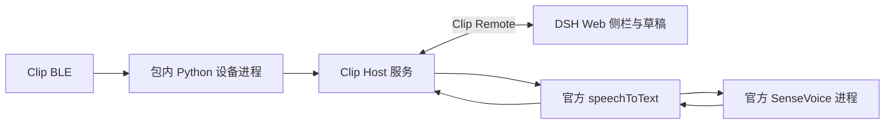

# Clip for DeepSeek Harness

用 reSpeaker Clip 录音，DSH 显示实时波形，停止录音后通过本机 SenseVoice 转写到聊天草稿。安装并启用插件后，DSH 会启动包内的 Python 设备进程。

## 版本兼容性

| DSH 版本 | DSH Host 平台 | Clip 版本 |
| --- | --- | --- |
| `0.2.2-rc.1` 或 `0.2.2-rc.3` | Windows x64、Linux x64 | `0.3.7` |

运行 DSH Host 的电脑需要蓝牙适配器。Linux 还需要 BlueZ。自行运行 DSH Web 时，Node.js 需为 `24.9.0` 或更高版本。Electron 桌面版使用应用自带的运行环境。

Clip 使用当前 DSH 版本随附的官方转写组件。切换 DSH 版本后，两个受支持版本可继续使用同一个 Clip 安装包。

Linux 上已验证两个 DSH 版本均能安装、扫描和使用本机 SenseVoice 转写。Windows CI 已验证 `rc.3` 桌面 CLI 安装、设备进程通信和 SenseVoice 加载。Windows 上的实机配对及录音转写尚待验证。[Windows CI 结果](https://github.com/Ant-wkp/dsh-clip-for-agent/actions/runs/44217672737)

## 方式一：应用内「插件管理」

在 Web 或 Electron 桌面版打开 **插件 → 添加插件**，输入 `dsh-clip-for-agent@0.3.7`。[npm 包页面](https://www.npmjs.com/package/dsh-clip-for-agent)

安装后启用插件。如界面提示重启，重启后在左侧栏打开 **Clip**。如果 `0.3.6` 在 `rc.1` 上报版本不兼容，安装 `0.3.7` 即可通过版本检查。

也可以在安装框粘贴以下 GitHub 地址。

```text
git+https://github.com/Ant-wkp/dsh-clip-for-agent.git#v0.3.7
```

## 方式二：命令行

| 你使用的界面 | Profile |
| --- | --- |
| `dsh web`（浏览器） | `web` |
| Electron 桌面应用 | `desktop` |

使用桌面应用时，先启动一次以初始化 `desktop` profile，再从应用自带的 DSH 终端运行命令。网页和桌面各选一条：

```bash
dsh plugin --profile web add dsh-clip-for-agent@0.3.7
dsh plugin --profile desktop add dsh-clip-for-agent@0.3.7
```

安装后启动或重启对应的 DSH 界面，并在插件管理中确认 Clip 已启用。也可以把命令中的包名换成上面的 GitHub 地址。

如果 `dsh --version` 显示 Dancer's Shell，Web 版可以用 `npx @deepseek-ai/dsh@0.2.2-rc.1` 或 `npx @deepseek-ai/dsh@0.2.2-rc.3` 代替命令中的 `dsh`。请选择与你现有 DSH Web 相同的版本。

## 方式三：从源码安装

```bash
git clone --branch v0.3.7 https://github.com/Ant-wkp/dsh-clip-for-agent.git
cd dsh-clip-for-agent
npm run build
```

然后按实际使用的界面选择一条命令：

```bash
# Linux · DSH Web
dsh plugin --profile web add "file:$(pwd)"
```

```powershell
# Windows PowerShell · Electron 桌面版自带的 DSH 终端
dsh plugin --profile desktop add "file:$($PWD.Path)"
```

`file:` 后填包含 `package.json` 和 `cordis.patch.yml` 的插件目录绝对路径。`npm run build` 生成 `lib/client.js`，使用仓库随附的 Windows 和 Linux x64 设备进程。修改 Python 设备代码后，请按下文重建对应进程。

## 使用 Clip

1. 在 DSH 左侧栏打开 **Clip**，点击 **扫描设备**，为设备选择 **配对连接**。
2. 回到要录入的聊天，在 Clip 上开始录音，聊天输入栏会显示实时波形。
3. 在 Clip 上停录，插件自动同步、解码并调用本地 SenseVoice。聊天仍处于可编辑状态且草稿版本与录音开始时一致时，转写插入当时的光标位置。
4. 录音期间修改草稿、切换聊天或关闭页面后，可从原聊天手动插入保留的文本。同步或转写失败时，可从 **Clip → 录音结果** 重试。蓝牙断开时，重试会先连接这条录音所属的 Clip。没有识别到语音时会显示状态。DSH 重启后，可从同一面板选择 **同步最近录音**，重读设备上最后一段已保存的录音。恢复结果在聊天中手动插入。

首次使用时，在 **Clip → 语音转写** 点击 **安装 SenseVoice 模型**，同一位置会显示下载进度。如果官方转写组件未启用，点击 **安装官方转写** 会在 Clip 面板发起安装或启用。DSH 需要重启才能加载组件时，面板会显示提示。模型缓存和官方语音插件共用。若已启用官方语音输入 bundle，Clip 复用已加载的官方服务和本地 SenseVoice。语音输入支持每段最多 120 秒，转写只写草稿，需要用户手动发送。



`clip` Remote 使用 DSH Gateway 的认证和状态流，并提供设备连接、模型准备、草稿绑定、任务重试和确认接口。Python 进程负责 SDK、BLE、CRC32 校验、续传和 Opus 解码，通过 `ctypes` 调用 libopus，按原规则在 Python 中执行双声道混音，输出 16 kHz 单声道 PCM16 WAV。WAV 留在本机 Host，Web 接收状态、波形和转写文本。同步缓存在确认结果或退出 DSH 后回收，转写失败后的重试可复用已下载的 WAV。

开发测试可在登录后的地址加 `?clip-demo=1`。测试环境和性能数据见 [性能记录](PERFORMANCE.md)。

开发构建需要当前 Clip SDK 源码，以及安装 PyInstaller 和 Bleak 的 Python 环境。

```bash
scripts/build-worker.sh /path/to/reSpeaker_Clip/sdk
npm run build:client
```

Windows x64 可用 GitHub Actions 的 **Build Windows Clip worker** 流程构建，或在安装 PyInstaller、Bleak 并准备好 x64 Opus DLL 后，在 PowerShell 执行：

```powershell
./scripts/build-worker.ps1 -Sdk C:/path/to/reSpeaker_Clip/sdk -OpusDll C:/path/to/opus.dll
npm run build
```
