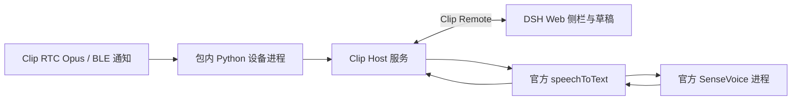

# Clip for DeepSeek Harness

用 reSpeaker Clip 的 RTC 模式，通过 BLE 实时接收 Opus 音频。DSH 在录音期间显示波形，停录后通过本机 SenseVoice 转写到聊天草稿。

## 版本兼容性

| DSH 版本 | DSH Host 平台 | Clip 版本 |
| --- | --- | --- |
| `0.2.2-rc.1` 或 `0.2.2-rc.3` | Windows x64、Linux x64 | `0.3.8-rtc.1` |

运行 DSH Host 的电脑需要蓝牙适配器。Linux 还需要 BlueZ。自行运行 DSH Web 时，Node.js 需为 `24.9.0` 或更高版本。Electron 桌面版使用应用自带的运行环境。

Clip 使用当前 DSH 版本随附的官方转写组件。切换 DSH 版本后，两个受支持版本可继续使用同一个 Clip 安装包。

RTC 实现基于本地 reSpeaker Clip `clip_agent` 分支的 SDK 和协议。设备需要支持 `AT+START=rtc`。若固件支持双击启停 RTC，连接后也可用实体按键录音。

## 方式一：应用内「插件管理」

在 Web 或 Electron 桌面版打开 **插件 → 添加插件**，粘贴下方的 GitHub 分支地址。

安装后启用插件。如界面提示重启，重启后在左侧栏打开 **Clip**。

```text
git+https://github.com/Ant-wkp/dsh-clip-for-agent.git#rtc
```

## 方式二：命令行

| 你使用的界面 | Profile |
| --- | --- |
| `dsh web`（浏览器） | `web` |
| Electron 桌面应用 | `desktop` |

使用桌面应用时，先启动一次以初始化 `desktop` profile，再从应用自带的 DSH 终端运行命令。网页和桌面各选一条：

```bash
dsh plugin --profile web add 'git+https://github.com/Ant-wkp/dsh-clip-for-agent.git#rtc'
dsh plugin --profile desktop add 'git+https://github.com/Ant-wkp/dsh-clip-for-agent.git#rtc'
```

安装后启动或重启对应的 DSH 界面，并在插件管理中确认 Clip 已启用。

如果 `dsh --version` 显示 Dancer's Shell，Web 版可以用 `npx @deepseek-ai/dsh@0.2.2-rc.1` 或 `npx @deepseek-ai/dsh@0.2.2-rc.3` 代替命令中的 `dsh`。请选择与你现有 DSH Web 相同的版本。

## 方式三：从源码安装

```bash
git clone --branch rtc https://github.com/Ant-wkp/dsh-clip-for-agent.git
cd dsh-clip-for-agent
npm run build
```

然后按实际使用的界面选择一条命令：

```bash
# Linux · DSH Web
dsh plugin --profile web add "file:$(pwd)"
```

```powershell
# Windows PowerShell · Electron 桌面版自带的 DSH 终端
dsh plugin --profile desktop add "file:$($PWD.Path)"
```

`file:` 后填包含 `package.json` 和 `cordis.patch.yml` 的插件目录绝对路径。`npm run build` 生成 `lib/client.js`，使用仓库随附的 Windows 和 Linux x64 设备进程。修改 Python 设备代码后，请按下文重建对应进程。

## 使用 Clip

1. 在 DSH 左侧栏打开 **Clip**，点击 **扫描设备**，为设备选择 **配对连接**。
2. 回到要录入的聊天，点击输入栏的 Clip 麦克风按钮开始 RTC 录音。也可在 Clip 面板开始，或用支持双击 RTC 的固件在设备端开始。录音期间，设备通过 BLE 实时发送 Opus。
3. 点击停止，或通过固件支持的设备按键停录。收到正常的结束帧后，插件解码音频并调用本机 SenseVoice。若仍在原聊天且草稿未变化，转写插入录音开始时的光标位置。否则可从结果手动插入。RTC 流开始 120 秒后会自动停录。
4. RTC 音频只在 DSH Host 的临时目录缓存。蓝牙中途断开或缺少结束帧时需要重录。音频已经完整接收、只在转写阶段失败时，可以重试。对于已写入设备 SD 卡的录音，仍可在 **Clip → 录音结果** 选择 **同步最近 SD 录音**。

首次使用时，在 **Clip → 语音转写** 点击 **安装 SenseVoice 模型**，同一位置会显示下载进度。如果官方转写组件未启用，点击 **安装官方转写** 会在 Clip 面板发起安装或启用。DSH 需要重启才能加载组件时，面板会显示提示。模型缓存和官方语音插件共用。若已启用官方语音输入 bundle，Clip 复用已加载的官方服务和本地 SenseVoice。语音输入支持每段最多 120 秒，转写只写草稿，需要用户手动发送。



`clip` Remote 使用 DSH Gateway 的认证和状态流。Python 设备进程调用 SDK 的 `start_rtc` 和 `stream_rtc`，接收 `STREAM_START`、`STREAM_DATA` 和 `STREAM_END` 通知。停录后通过 libopus 解码为 16 kHz 单声道 PCM16 WAV，交给本机 SenseVoice。Web 端接收状态、波形和转写文本。SD 录音的下载仍使用 SDK 文件传输和 CRC32 校验。

开发测试可在登录后的地址加 `?clip-demo=1`。[性能记录](PERFORMANCE.md) 的音频传输耗时对应旧版 SD 同步流程。

开发构建需要当前 Clip SDK 源码，以及安装 PyInstaller 和 Bleak 的 Python 环境。

```bash
scripts/build-worker.sh /path/to/reSpeaker_Clip/sdk
npm run build:client
PYTHONPATH=/path/to/reSpeaker_Clip/sdk/src:worker python -m unittest discover -s tests
```

Windows x64 可用 GitHub Actions 的 **Build Windows Clip worker** 流程构建，或在安装 PyInstaller、Bleak 并准备好 x64 Opus DLL 后，在 PowerShell 执行：

```powershell
./scripts/build-worker.ps1 -Sdk C:/path/to/reSpeaker_Clip/sdk -OpusDll C:/path/to/opus.dll
npm run build
```
